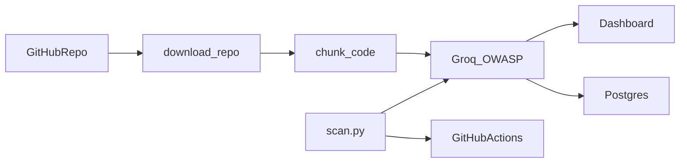

# DevSecOps Analyzer

[](https://github.com/Emirhanblc/devsecops_analyzer/actions/workflows/security-scan.yml)
[](https://www.python.org/downloads/release/python-3110/)
[](LICENSE)


> GitHub deposunu Groq üzerindeki bir sohbet modeliyle tarar. OWASP Top 10 kapsamındaki kritik ve yüksek açıkları dosya, satır ve düzeltme önerisiyle panele yazar. Her push ve pull request’te aynı tarama CI’da çalışır. Uygulama kodunda bulgu varsa pipeline kırmızıya düşer.

An LLM scanner for public GitHub repositories. Paste a repo URL, get critical and high OWASP findings with file, line, and a short fix. The same check runs in GitHub Actions: application code must stay clean, and a separate job must still catch the intentional SQL injection sample.

## Dashboard


## What it does

- Downloads the default branch of a **public** GitHub repository as a zipball. No token, no private repos.
- Reads source files (`.py`, `.js`, `.ts`, `.java`, `.c`, `.cpp`, `.go`, `.html`, `.php`, `.cs`). Skips `node_modules`, virtualenvs, `tests`, `docs`, `examples`, minified files, and anything over 500 KB.
- Splits each file into 8,000-character chunks and asks Groq for JSON findings. Default model is `qwen/qwen3.8-27b`. Override it with `GROQ_MODEL`.
- Keeps only what the model reports as critical or high. Shows name, file, line, and a fix in the dashboard.
- Stores each finding in PostgreSQL. **Geçmiş Taramaları Gör** reads `GET /api/history`.
- In CI, `python scan.py` scans `app/` and `scan.py`. A finding or a failed Groq call fails the job.
- `python scan.py --fixture` scans only [`test_vuln.py`](test_vuln.py). The job passes when the model reports SQL injection, and fails when it does not.

`test_vuln.py` is not production code. The SQL injection in it is deliberate, so the second CI job can prove the scanner still sees a known bug.

## How a scan moves



The dashboard sends at most five Groq calls at once, with one second between them. CI uses two calls at once and a two-second delay. On HTTP 429 the client waits 16 seconds and retries, up to three attempts. Temperature is 0.2, and the response must be a JSON object.

## Run it

You need Docker, and a Groq API key.

```bash
cp .env.example .env
```

Set `GROQ_API_KEY` in `.env`. Optionally set `GROQ_MODEL`.

```bash
docker compose up --build
```

Open [http://localhost:8080](http://localhost:8080).

Compose starts PostgreSQL 15 and the FastAPI app. These database credentials are for this local demo only. Do not reuse them on a shared machine.

- User: `secuser`
- Password: `secpass123`
- Database: `secdb`
- Host inside Compose: `db`
- Host from your machine: `localhost:5432`

To run the app on the host and keep Postgres in Docker:

```bash
docker compose up -d db
pip install -r requirements.txt
uvicorn app.main:app --reload --port 8000
```

Open [http://localhost:8000](http://localhost:8000). Outside a container, [`app/database.py`](app/database.py) connects to `localhost` unless `DATABASE_URL` or `DB_HOST` is set.

Scan this repo from the project root (`.env` is loaded automatically):

```bash
python scan.py
python scan.py --fixture
```

The image built from the [`Dockerfile`](Dockerfile) is the dashboard only. CI runs `scan.py` on the GitHub runner, not inside that image.

## API

`POST /analyze-repo`

```bash
curl -X POST http://localhost:8080/analyze-repo \
  -H "Content-Type: application/json" \
  -d "{\"github_url\":\"https://github.com/owner/repo\"}"
```

The JSON below shows the response shape. It is not a finding from this repository. There is no `app/db.py` here.

```json
{
  "taranan_dosya_sayisi": 12,
  "bulgular": [
    {
      "name": "SQL Injection",
      "file_name": "app/db.py",
      "line_number": "40",
      "recommendation": "Use a parameterized query."
    }
  ]
}
```

Turkish keys (`zafiyet_adi`, `dosya_adi`, `satir_numarasi`, `cozum_onerisi`) are included on each finding as well.

`GET /api/history` returns saved rows, newest first: `repo_url`, `file_name`, `vulnerability_name`, `line_number`, `suggestion`, `created_at`.

`POST /fetch-repo` only downloads and extracts. It does not scan.

## CI

[`.github/workflows/security-scan.yml`](.github/workflows/security-scan.yml) runs on every push and pull request. Both jobs need the `GROQ_API_KEY` repository secret. The second job waits for the first so the two scans do not share Groq’s per-minute token budget.

| Job | Command | Passes when |
| --- | --- | --- |
| Uygulama kodu taraması | `python scan.py` | `app/` and `scan.py` have no critical or high finding, and every Groq call succeeds |
| SQL Injection örneği yakalanıyor | `python scan.py --fixture` | The model reports SQL injection in `test_vuln.py` |

Exit codes for both commands: `0` pass, `1` the security expectation failed, `2` configuration or API failure. An API error is never treated as a clean scan.

On a failing application scan, findings are also written as GitHub Actions `::error` annotations on the file and line.

## Limits

- Findings are model output. Read them before you change production code. The scanner is not Semgrep or CodeQL.
- Only critical and high issues are requested. A quiet report is not a proof that the repo is safe.
- Line numbers are the model’s, on a character-sliced chunk. Treat them as a hint.
- Public default-branch zipballs only. Private repos and non-default branches are out of scope.
- Large repositories can take minutes and can hit Groq rate limits even with retries.
- Fork pull requests do not receive repository secrets, so the workflow cannot call Groq there.

## Layout

```
app/                  FastAPI app, dashboard, Groq client, GitHub download
scan.py               CI entry point
test_vuln.py          Intentional SQL injection fixture
.github/workflows/    Application scan, then fixture detection
```

## License

[MIT](LICENSE) © Emirhanblc
